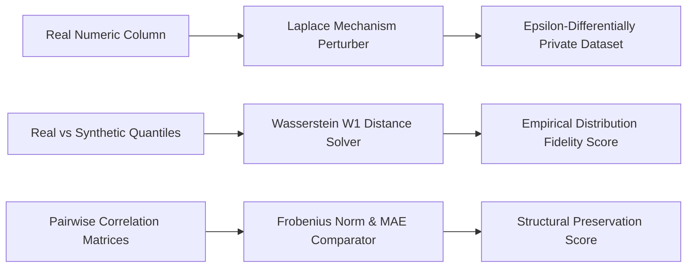

# genpark-wukong-data-synthesizer


GenPark Wukong Data Synthesizer is a zero-dependency differential privacy and synthetic data validation engine implementing the Laplace mechanism for privacy budget $\epsilon$, 1D Wasserstein Earth Mover's Distance distribution fidelity scoring, and Frobenius norm correlation preservation matrices.



## Features
- **Laplace Differential Privacy**: Synthesizes noise scaled to $b = \Delta f / \epsilon$ with rigorous 95% confidence intervals.
- **Wasserstein Distance Metric**: Measures exact Earth Mover's Distance $W_1$ normalized to empirical interquartile ranges.
- **Correlation Matrix Fidelity**: Verifies that synthetic feature covariance matrices preserve underlying multivariate relationships.

## Quickstart

```python
from client import GenParkWukongDataSynthesizer

synth = GenParkWukongDataSynthesizer()
res = synth.generate_laplace_differential_privacy_noise(100.0, epsilon=1.0)
print("Privatized Value:", res["privatized_value"])
```

## License
MIT
